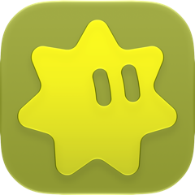

<p align="center">
  
</p>

<h1 align="center">Iskra</h1>

<p align="center">
  A native <a href="https://matrix.org">Matrix</a> client for iPhone, iPad and Mac.<br>
  One SwiftUI codebase, with all Matrix and cryptography work done by
  <a href="https://github.com/matrix-org/matrix-rust-sdk">matrix-rust-sdk</a>.
</p>

<p align="center">
  
  
  <a href="LICENSE-EXCEPTION.md"></a>
</p>

## What it does

- **Chats as you expect them** — DMs, groups and spaces, replies, edits, reactions, pins,
  mentions, polls, locations, files, voice messages and round video messages.
- **End-to-end encryption** with device verification and key backup.
- **Notifications that say something** — an encrypted push is decrypted on the device, so
  the lock screen shows the message, and the server never could.
- **Several accounts** on one device, a tap apart.
- **Widgets, Live Activities, Siri and Shortcuts.**
- **Seven languages**: English, Russian, German, Spanish, French, Japanese, Chinese.
- **A way around a blocked network.** Where the homeserver cannot be reached directly,
  the connection can be carried over [nostr](https://nostr.com) through a
  [bridge](https://github.com/iskra-app/iskra-bridge) — which sees only the host and the byte counts, because the
  TLS runs end to end through it.

## Privacy

- Tokens and store keys live only in the Keychain, never synced or backed up.
- The message store and the search index are encrypted on disk; search never leaves the
  device.
- Photos and videos are sent without their metadata by default.
- Nothing logs messages, tokens or passwords.
- All Matrix cryptography is the Rust SDK's — none of it is reimplemented here.

## Building

You need Xcode 26 or later and
[XcodeGen](https://github.com/yonaskolb/XcodeGen) (`brew install xcodegen`).

```sh
swift build && swift test         # the libraries, where all the behaviour lives
./run.sh                          # the app on the Mac and in the iPhone simulator
./run.sh ios --mock-backend       # with the built-in demo server: every screen has something on it
```

The Xcode project is generated from `Apps/project.yml`. To sign your own build, put your
team in `DEVELOPMENT_TEAM` and your own prefix in `bundleIdPrefix` there.

The bridge is a separate Rust service in its own repository,
[`iskra-app/iskra-bridge`](https://github.com/iskra-app/iskra-bridge), where its images and
releases are published.

## Layout

| | |
|---|---|
| `Core/` — **IskraCore** | Sessions, secrets, rooms, timeline, search, media, the bridge client. Never SwiftUI. |
| `Sources/IskraDesign` | Bubbles, glass, spacing, colour. Never Matrix. |
| `Sources/IskraFeatures` | The screens — the only place the two meet. |
| `Apps/` | Thin app shells, the notification, share and widget extensions. |
| `docs/` | Design notes: [why things are the way they are](docs/DECISIONS.md), the [blind bridge](docs/BLIND-BRIDGE.md), the [push gateway](docs/PUSH-GATEWAY.md). |

What is done and what is next is in [`ROADMAP.md`](ROADMAP.md). The working guide to the
code — its rules and the mistakes they prevent — is [`CLAUDE.md`](CLAUDE.md).

## Contributing

Welcome. Please read [`CONTRIBUTING.md`](CONTRIBUTING.md) first: every commit is signed
off, and the sign-off includes agreeing that the app may be published through app stores.

## Licence

Iskra is [GPL-3.0](LICENSE) with an
[additional permission for app stores](LICENSE-EXCEPTION.md). The
[bridge](https://github.com/iskra-app/iskra-bridge) is MIT. Generated avatars are a port of [blobatar](https://blobatar.dev),
MIT ([notice](Licenses/blobatar.txt)).
